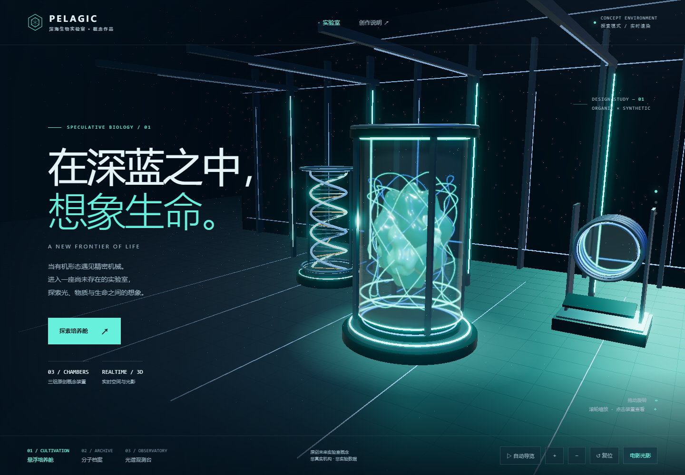
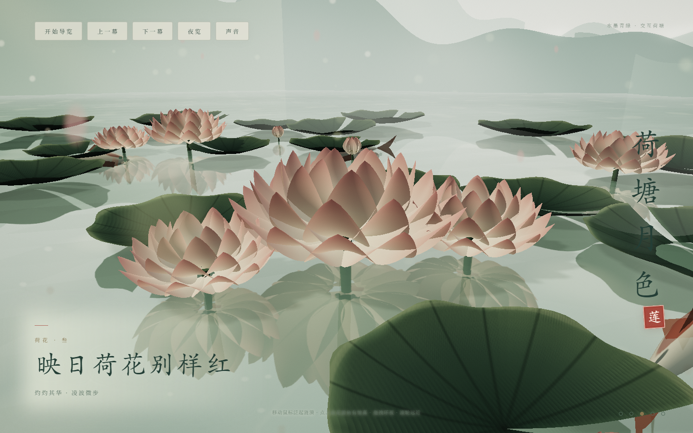
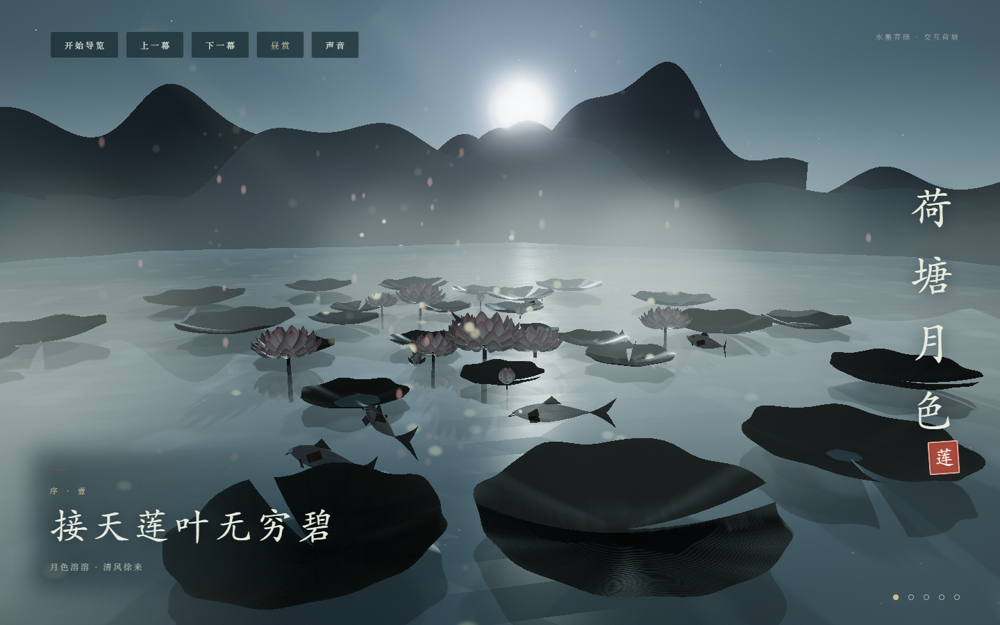

# HTML Showcase

我的第一个 GitHub 项目：用单文件 HTML 展示实时三维空间与国风水墨场景。

两个展示项目均由 **Codex 使用本仓库的 [html-showcase 技能](skills/html-showcase/SKILL.md) 制作与迭代**。PELAGIC 由 Codex 按选定方向原创构建；荷塘月色由 Codex 基于用户提供的 v7 源码完成水墨重绘、交互完善与验收。`archive/` 保存输入原版，不将其原始制作归因于本次重绘。

项目包含两件可独立打开的作品：未来生物实验室 **PELAGIC**，以及水墨青绿风格的 **荷塘月色**。模型、纹理、装饰和荷塘环境音由程序生成，无需安装 npm 或执行构建。

## 在线体验

无需下载，点击即可进入展示页：

- [作品入口](https://citystarfine.github.io/html-showcase/)
- [PELAGIC · 未来生物实验室](https://citystarfine.github.io/html-showcase/projects/pelagic-lab/)
- [荷塘月色 · 水墨青绿](https://citystarfine.github.io/html-showcase/projects/lotus-pond/)

通过 GitHub Pages 发布，更新 `main` 后网站自动更新。三维场景加载固定版本 CDN 库，声音需要点击按钮后开启。
## 作品

### PELAGIC · 未来生物实验室



深海蓝与青色辉光构成原创实验室概念空间，包含玻璃培养舱、双螺旋分子档案和光谱观测台。支持旋转、缩放、物体拾取、信息面板、相机路点和自动导览。仪器与功能均为艺术设想，不对应真实实验设备或科研成果。

[页面源码](projects/pelagic-lab/index.html) · [设计与使用说明](docs/pelagic-lab.md)

### 荷塘月色 · 水墨青绿





五章诗句串联昼夜荷塘：真反射水面、荷叶与荷花、锦鲤、分层雾气、萤火与花瓣、合成环境音。支持风与涟漪交互、荷花绽放、鱼群受惊、拖拽缩放、昼夜切换和自动导览。

[页面源码](projects/lotus-pond/index.html) · [重绘与验收说明](docs/lotus-pond-redesign.md) · [原 v7 备份](archive/lotus-pond-v7.html)

## 运行

直接用现代浏览器打开根目录 `index.html`，点击作品卡片进入场景。两个作品的 HTML 也可分别直接打开。

如需本地 HTTP 预览，在本仓库目录运行：

```bash
python -m http.server 8000
```

然后访问 `http://localhost:8000`。这只是预览服务，无需构建。

首次加载需要联网获取固定版本的 three.js：实验室锁定 **0.170.0**，荷塘锁定 **0.160.0**。业务代码、样式和纹理均在各自 HTML 内；CDN 或 WebGL 不可用时显示静态摘要。

## 操作

| 作品 | 操作 |
| --- | --- |
| 实验室 | 拖动旋转；滚轮或 ＋ / − 缩放；悬停与点击装置；章节按钮；导览、复位与流畅模式 |
| 荷塘 | 指针带起风或涟漪；点击荷花、锦鲤、水面；拖动环视；滚轮缩放；方向键/空格切章；昼夜与声音按钮 |

## 文件结构

```text
html-showcase-project/
├── index.html                   # 两个作品的本地入口
├── projects/
│   ├── pelagic-lab/index.html    # 实验室完整单文件代码
│   └── lotus-pond/index.html     # 荷塘完整单文件代码
├── skills/html-showcase/        # 可复用 Codex 技能、模板和生成脚本
├── docs/                        # 设计、改动与验收文档
├── assets/previews/             # 浏览器截图
└── archive/lotus-pond-v7.html    # 荷塘原始版本备份
```

## 使用同一个技能制作新作品

[技能入口](skills/html-showcase/SKILL.md) · [技能工作流](skills/html-showcase/README.md)

技能包含 T1/T2/T3 三个技术等级、七套视觉预设、首次需求的可点击选择、材料来源选择、程序化装饰规则和单文件生成脚本。用户已明确的选择会保留；T3 动工前需要明确确认。

将整个 `skills/html-showcase` 文件夹复制到用户技能目录，保留旁边的模板和脚本。Windows 用户级目录为 `%USERPROFILE%\.agents\skills\html-showcase\`；如果父目录不存在，先创建它。Codex 未显示该技能时重新启动。

在 Codex 中调用示例：

```text
$html-showcase
帮我制作一个未来生物实验室展示页，对美术与三维光影要求较高。
内容采用原创概念，用于作品集；先让我选择视觉方向、技术等级与交互方式。
```

也可以在工作目录启动需求按钮向导（只保存 intake，不自动生成项目）：

```bash
python /path/to/html-showcase/skills/html-showcase/new.py
```

脚本依次记录用途、风格、配色、美术完成度、等级、内容来源、素材授权和验收标准，保留已有明确选择；T3 单独二次确认。用户先从 2–3 个视觉方向中选定，再确认完整构图、关键画面与素材方案，才能通过 `--build --plan` 生成基础单文件。最终内容、美术、模型、交互与浏览器验收仍由 Codex 完成；学术用途还需逻辑主线、关系图示、章节过渡和陌生真人复述验收。详见 [需求与方案接口](skills/html-showcase/references/intake.md)。仓库中的两件作品展示的是完成后的定制成果。

修改永久工作流请编辑 `skills/html-showcase/SKILL.md`；修改默认视觉与布局请编辑技能的 `styles/`、`templates/` 与 `js/`；修改当前作品请编辑对应 `projects/*/index.html`。本仓库保存技能快照，更新后需要同步到已安装的技能目录。
## 修改

直接编辑对应作品的 `index.html`。实验室的配色在 CSS 变量中，仪器说明与相机路点在脚本的 `data` 和 `points` 中；荷塘的章节在 `SECTIONS` 中，色彩与后期在昼夜插值代码和 `GradeShader` 中。

[验证范围与限制](docs/validation.md)。目标为 60fps；实际性能取决于浏览器、分辨率和设备。荷塘音效需点击“声音”后开启。